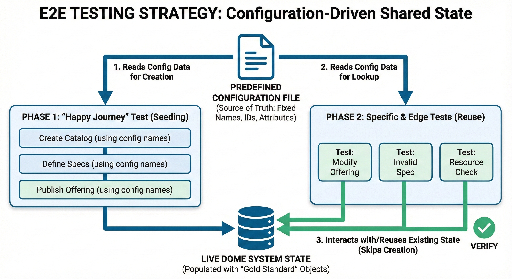

# E2E-DOME-BAE

**Important:** If you are using macOS, you may experience significantly longer test execution times. This is due to a performance bottleneck in the TMForum API container, which is not optimized for native ARM architecture.

## Table of Contents

- [Testing Strategy: Configuration-Driven Shared State](#testing-strategy-configuration-driven-shared-state)
  - [Workflow Explanation](#workflow-explanation)
- [Usage](#usage)
  - [Run system tests](#run-system-tests)
  - [Clean and restart](#clean-and-restart)
  - [Tests with UI](#execute-tests-manually-with-ui)
  - [CI/CD](#you-can-integrate-the-tests-in-your-cicd)
- [Requirements](#requirements)

## Testing Strategy: Configuration-Driven Shared State

This project uses an optimized End-to-End (E2E) testing strategy with Cypress, designed to minimize execution time and avoid redundant data creation.

Because the marketplace flow has heavy sequential dependencies (Catalog $\rightarrow$ Specs $\rightarrow$ Offering), creating fresh foundational data for every single test is highly inefficient.

Instead of re-creating data or passing data dynamically between tests, we use a **configuration-driven approach** where a predefined file acts as the single source of truth for test data identifiers.

Our strategy is visualized below:



### Workflow Explanation

**The Source of Truth: Predefined Configuration File**
Before any tests run, a static configuration file exists containing fixed names, and other attributes for the required Catalog, Specs, and Offering. This ensures every test knows exactly "who" corresponds to "what".

**1. Phase 1: The "Happy Journey" (Seeding the System)**
* The main, positive-flow test executes first.
* It reads the **Predefined Configuration File** to know exactly what names and attributes to use.
* It executes and tests the creation actions against the live DOME system, effectively populating the environment with the expected "gold standard" objects.

**2. Phase 2: Specific & Edge Tests (Reuse)**
* Subsequent tests execute only after Phase 1 has successfully seeded the environment.
* These tests also read the **Predefined Configuration File** to find the fixed identifiers of the objects they need to interact with.
* They **skip creation steps** and directly interact with the live system, reusing the existing Catalogs, Specs, or Offerings to perform specific verifications or test edge-case scenarios.

This ensures deep test coverage without wasting time constantly rebuilding the foundational data structures.

## Usage

### Run system tests

To deploy the complete system and run the tests:

```bash
./testing-local.sh [--headed] [--noTest] <proxy_branch> <proxy_repo> <charging_branch> <charging_repo> <frontend_branch> <frontend_repo> <tm_version>
```

**Optional flags:**
- `--headed` - Run Cypress tests with GUI (default: headless mode)
- `--noTest` - Skip running tests (only build and deploy the system)

**Examples:**

Headless mode (default):
```bash
./testing-local.sh master FIWARE-TMForum/business-ecosystem-logic-proxy master FIWARE-TMForum/business-ecosystem-charging-backend main Ficodes/BAE-Frontend 1.3.18
```

With GUI (headed mode):
```bash
./testing-local.sh --headed master FIWARE-TMForum/business-ecosystem-logic-proxy master FIWARE-TMForum/business-ecosystem-charging-backend main Ficodes/BAE-Frontend 1.3.18
```

Only build and deploy (skip tests):
```bash
./testing-local.sh --noTest master FIWARE-TMForum/business-ecosystem-logic-proxy master FIWARE-TMForum/business-ecosystem-charging-backend main Ficodes/BAE-Frontend 1.3.18
```

This command:
1. Clones the specified repositories on the indicated branches (It doesn't overwrite existing directories, to change repo/branch, it is required to remove the frontend/proxy/charging repo previously)
2. Builds the necessary Docker images
3. Deploys all services (proxy, charging, frontend, IDM, TMForum APIs, etc.)
4. Runs end-to-end tests with Cypress (headless by default, with GUI if `--headed` flag is used, or skip tests entirely with `--noTest`)

### Clean and restart

To empty the database and start over:

```bash
./cleanup.sh
```

### Reload after brought up to date (proxy and charging)

After brought the new changes (for example with git fetch --all and git pull ) you can start over with the new modifications using this command:

```bash
./reload.sh
```

### Execute tests manually with UI

If the system is already deployed, you can execute this command:
```bash
npx cypress open --e2e
```

If nothing is deployed yet, use the `--headed` flag when running the testing script:
```bash
./testing-local.sh --headed master FIWARE-TMForum/business-ecosystem-logic-proxy master FIWARE-TMForum/business-ecosystem-charging-backend main Ficodes/BAE-Frontend 1.3.18
```

### You can integrate the tests in your CI/CD
From your forked BAE-Frontend you can send a PR to the original repo (Ficodes/BAE-Frontend) with the following data
This is the minimal text you need to trigger the system testing workflow
```txt
SYSTEM_TESTING: ACTIVATE
TM_VERSION: 1.3.18
```
And this is for custom testing
```txt
SYSTEM_TESTING: ACTIVATE [needed to activate the workflow]
PROXY: https://github.com/FIWARE-TMForum/business-ecosystem-logic-proxy/tree/develop [This line is optional; default it will take master branch]
CHARGING: https://github.com/FIWARE-TMForum/business-ecosystem-charging-backend/tree/develop [This line is optional; default it will take master branch]
TM_VERSION: 1.3.18
```
SYSTEM_TESTING: [needed to activate the workflow]
PROXY: [This line is optional; default it will take master branch]
CHARGING: [This line is optional; default it will take master branch]
TM_VERSION: Mandatory to se the tmforum api version

It is going to test your current Pull requested front repo@branch with the repo@branch of proxy and charging (optional) and tmforum api that you previously chose

### Select the E2E workflow branch

Use `workflow_dispatch` on `cross-repo-test.yml` to select **both the workflow
definition and the test code** from an E2E branch. Set the request's top-level
`ref` to that branch (or a tag). Checkout is pinned to `github.sha`, the commit
GitHub resolved for that ref when the run was triggered. The backend/frontend
branches are separate inputs; they do not select the E2E workflow.

Create a JSON request file, for example `dispatch.json`:

```json
{
  "ref": "fix/recover-plugins",
  "inputs": {
    "suite": "plugins",
    "repository_A": "FIWARE-TMForum/business-ecosystem-logic-proxy",
    "branch_A": "feat/plugin-recover",
    "repository_B": "FIWARE-TMForum/business-ecosystem-charging-backend",
    "branch_B": "fix/recover-plugins",
    "repository_frontend": "Ficodes/BAE-Frontend",
    "branch_frontend": "feat/plugin-recover",
    "tm_version": "1.15.1",
    "pull_request_url": "https://github.com/FIWARE-TMForum/business-ecosystem-charging-backend/pull/123",
    "from": "charging"
  }
}
```

Replace the example branches and PR URL with existing ones, then send:

```bash
curl --fail-with-body --request POST \
  --header "Accept: application/vnd.github+json" \
  --header "Authorization: Bearer $GH_TOKEN" \
  --header "X-GitHub-Api-Version: 2022-11-28" \
  --header "Content-Type: application/json" \
  --data-binary @dispatch.json \
  https://api.github.com/repos/Ficodes/E2E-DOME-BAE/actions/workflows/cross-repo-test.yml/dispatches
```

| Input | Required | Meaning / default |
| --- | --- | --- |
| `suite` | No | `all` (default), `dpas`, `redsys`, or `plugins`; `all` runs the three cases on separate stacks |
| `repository_A` | Yes | Proxy repository, `owner/repo` |
| `branch_A` | No | Proxy branch; `master` |
| `repository_B` | Yes | Charging repository, `owner/repo` |
| `branch_B` | No | Charging branch; `master` |
| `repository_frontend` | Yes | Frontend repository, `owner/repo` |
| `branch_frontend` | No | Frontend branch; `master` (set `main` explicitly when needed) |
| `tm_version` | Yes | TMForum API image version |
| `pull_request_url` | No | Source PR whose head commit receives pending/success/failure statuses; omitted means no status reporting |
| `from` | No | `charging` selects the existing `FIWARE_ADMIN` status token; other values or omission select `ADMIN` |

There is no `cypress_branch` input for manual dispatch: the E2E selection belongs
in top-level `ref`. The selected branch supplies the job matrix and test suite
selection, as well as the scripts and tests. All needed files must be committed
and pushed to that branch; local untracked files are unavailable to GitHub.

**Existing integrations:** callers using
`POST /repos/Ficodes/E2E-DOME-BAE/dispatches` with
`event_type: cross-repo-test` and `client_payload` remain supported unchanged.
That legacy event uses the default branch's workflow definition; its optional
`client_payload.cypress_branch` selects only the test code. To test workflow
changes too, change the caller to the workflow-specific endpoint above, move
the dependency/status fields from `client_payload` to `inputs`, move
`cypress_branch` (for example, the parsed `E2E_BRANCH` PR field) to top-level
`ref`, and remove `event_type`. When no E2E branch is supplied, the caller must
set `ref` explicitly to the E2E repository's default branch (`master`). This
change must be made in each calling frontend/charging integration; updating only
this repository cannot change the event those callers send.
The optional suite selection moves from `client_payload.suite` to
`inputs.suite`; omitting it continues to run all three cases.

The dispatching credential needs access to the E2E repository and **Actions:
write** for a fine-grained token (or `repo` scope for a classic PAT). Existing
tokens used for repository dispatch may need that permission added. The
`ADMIN`/`FIWARE_ADMIN` secrets used inside the E2E run still need permission to
read the source PR and write commit statuses in its repository; those are
separate from permission to dispatch the workflow. API clients should accept
the endpoint's successful 2xx response rather than assume the legacy endpoint's
204 response is the only success code.

**One-time default-branch setup:** register/enable
`.github/workflows/cross-repo-test.yml` with `workflow_dispatch` on the E2E
repository's default branch, retaining `repository_dispatch` for old callers.
Also include `workflow_dispatch` and its inputs in each target branch's copy of
that workflow. Thereafter pipeline changes can stay on a feature branch and be
tested via `ref` before merging them into `master`. This setup does not require
merging each feature branch's pipeline changes first. GitHub Actions must be
enabled and the referenced branches/tags must exist in the E2E repository.

See GitHub's [workflow dispatch API](https://docs.github.com/en/rest/actions/workflows#create-a-workflow-dispatch-event)
and [dispatch event behavior](https://docs.github.com/en/actions/reference/workflows-and-actions/events-that-trigger-workflows#workflow_dispatch).

## Requirements

- Docker and Docker Compose
- Node.js and npm
- Python 3
- Git

**Note:** The script automatically detects if you're on macOS or Linux and adjusts dependency installation accordingly.

## Independent plugin suite

### Run from committed local feature repositories

Use the isolated local stack when the repositories already exist on this machine:

```bash
python3 scripts/plugin-stack.py prepare \
  --frontend /path/to/BAE-Frontend \
  --proxy /path/to/business-ecosystem-logic-proxy \
  --charging /path/to/business-ecosystem-charging-backend
python3 scripts/plugin-stack.py up
python3 scripts/plugin-stack.py run
python3 scripts/plugin-stack.py run --suite core
python3 scripts/plugin-stack.py run --suite all
```

Preparation uses `git archive HEAD` for each repository. **Uncommitted changes
and untracked files are excluded**, including charging work in progress. The
original working copies and branches remain untouched. Source paths, branches,
exact commit SHAs and ports are recorded in
`.local/plugin-stack/provenance.json`. Test configuration overlays are applied
only to the copied frontend environment files. Its development server forwards
`/api` to the isolated proxy, keeping browser requests on one origin without
patching the backend's committed CORS/login implementation.

This stack has its own Docker network, named volumes, identity application and
test organizations. It uses frontend port 4300, proxy 8104, charging 8106, IDM
3100, billing mock 4301, TMForum 8733 and Scorpio 11026, preserving an existing development
stack on the usual ports. The frontend is compiled from its committed snapshot;
matching installed dependencies can be copied from the source checkout.

Run only administration, or stop the isolated instance while retaining its data:

```bash
python3 scripts/plugin-stack.py run -- --spec cypress/e2e/plugins/administration.cy.ts
CYPRESS_PLUGIN_SCENARIO=files python3 scripts/plugin-stack.py run -- --spec cypress/e2e/plugins/journey.cy.ts
python3 scripts/plugin-stack.py down
```

The helper requires Python 3.12+, Docker Compose, Node/npm and the existing local
hostname mapping `127.0.0.1 idm.docker`. Deployment and frontend logs can be saved
under `.local/plugin-stack/`; that directory is ignored by Git. The default
TMForum image is 1.15.1 (`prepare --tm-version` selects another version).
The isolated helper and plugin case use the default DPAS setup for purchases.

### Run against an existing test stack

Run against a deployed test stack whose frontend, proxy and charging backend all
include the service/resource plugin feature:

```bash
npm run test:e2e:plugins
npm run test:e2e:core
```

`plugins` selects only `cypress/e2e/plugins/**/*.cy.ts`. `core` excludes that
directory. `npm run test:e2e` runs both. To select one plugin spec:

```bash
npm run test:e2e:plugins -- --spec cypress/e2e/plugins/administration.cy.ts
```

The deployment script also respects suite selection:

```bash
E2E_SUITE=plugins ./testing-local.sh <proxy_branch> <proxy_repo> <charging_branch> <charging_repo> <frontend_branch> <frontend_repo> <tm_version>
```

The PR and cross-repository workflows have three peer cases in a single flat
list:

| Case | Specs |
| --- | --- |
| `dpas` | Existing full suite, excluding plugin specs |
| `redsys` | Existing happy-journey and billing/payment-scheduler specs |
| `plugins` | Plugin administration and specification-to-purchase journeys |

Each case runs once on its own runner and stack, with its own status and
artifacts. There is no suite/payment-method cross-product. With no selection,
all three run in parallel. Manual workflow dispatch accepts `suite: all`,
`dpas`, `redsys`, or `plugins`; repository dispatch accepts the same optional
`suite` field in `client_payload`. Selecting one runs only that case.

For an already configured stack, `E2E_SUITE=dpas` or `E2E_SUITE=redsys` selects
the corresponding specs with `npm run test:e2e`. The existing `core` local
command remains a compatibility alias for non-plugin specs.

Do not run these jobs concurrently against one shared stack: plugin management,
the payment mock, and termination recovery have global state. Parallelize using
separate runners/stacks, rather than concurrent Cypress processes against the
same deployment.

### Plugin coverage

Plugin flows navigate through the account and Browse menus, workspace Back
buttons, inventory sections, and inventory rows. Checkout follows the
application's payment redirect. `cy.visit('/')` opens the application when
establishing or restoring the login session; subsequent view changes use the UI.

- Administration separately tests service/resource installation, immediate editor
  availability, upgrades with stable category IDs, equal/older version conflicts,
  malformed uploads, deletion confirmation/cancellation, removal and anonymous
  access rejection.
- Each journey creates its own service/resource specifications, catalog, product,
  offering and purchase, and ensures a real billing address exists. No core happy-journey data or
  administration-test execution is required.
- Journey variants cover file/form plugins, restored and edited configuration,
  mandatory fields and explicit boolean `false`, backend validation of tampered
  payloads, pre-hook rejection followed by correction, tolerated post-hook
  failure, blocked activation, manual/payment-automatic procurement, and
  termination with cleanup failure and recovery.
- Assertions inspect real callback arguments and inventory state. File journeys
  click Download as the purchaser in both service and resource inventory and
  verify that the downloaded file matches the uploaded contents. No callback or
  catalog response is stubbed. Bundles and unwired lifecycle hooks are excluded.

The tests use the frontend's account-menu, dynamic plugin-field, managed-file,
save/discard, confirmation-dialog and inventory entity-ID hooks. In frontend
commit `8c90f4c3`, these controls still need dedicated hooks; the tests currently
use their visible text or scoped HTML structure. Paths below are relative to
`BAE-Frontend/src/app/`:

| Proposed `data-cy` | Control | Frontend template |
| --- | --- | --- |
| `inventoryProductOpen` | Product title button | `pages/product-inventory/inventory-items/inventory-products/inventory-products.component.html:69` |
| `inventoryCardStatus` | Product status badge | `pages/product-inventory/inventory-items/inventory-products/inventory-products.component.html:58` |
| `closeInvoiceDetails` | Invoice detail Close button | `pages/product-orders/sections/invoices-info/invoices-info.component.html:167` |
| `offerCancel` | Cancel on the first offering-editor step | `shared/forms/offer/offer.component.html:724` |

### Fixtures and prerequisites

The suite uses the IDM administrator and `SELLER ORG` / `BUYER ORG` created by
`testing-local.sh`, the normal billing mock, Python 3 on the test runner, and
Docker access to charging. Optional environment settings:

| Setting | Default | Purpose |
| --- | --- | --- |
| `BAE_E2E_CHARGING_CONTAINER` | `charging-docker-charging-1` | Charging container used by fixture/recovery tasks |
| `BAE_E2E_PYTHON` | `python3` | Python executable used to generate fixture ZIPs |
| `BAE_E2E_CHARGING_PYTHON` | `python3.9` | Python executable with Django inside charging |
| `CYPRESS_PROXY_URL` | `http://localhost:8004` | Proxy URL for authenticated assertion requests |
| `CYPRESS_CHARGING_URL` | `http://localhost:8006` | Charging API used by core scheduler checks |
| `CYPRESS_TMF_URL` | `http://localhost:8633` | TMForum APIs used by core checks |
| `CYPRESS_SCORPIO_URL` | `http://localhost:1026` | Context broker used by core billing checks |
| `CYPRESS_IDM_ORIGIN` | `http://idm.docker:3000` | Browser origin for IDM login |
| `CYPRESS_BILLING_SERVER_URL` | `http://localhost:4201` | Billing mock URL used by Cypress |

`cypress/plugins/fixture.py` builds self-contained service/resource packages with
the current manifest and hook interfaces. Each invocation of Cypress uses unique
plugin IDs and entity names. ZIPs are generated under ignored
`cypress/.plugins/<run-id>/`; no packages from another repository are copied or
required. Journey setup installs fixtures through charging's real `loadplugin`
command. The administration test instead exercises installation through the UI
using separate plugin IDs.

Callbacks append JSON records under `/tmp/bae-e2e-plugins-<run-id>.jsonl` inside
charging, protected by file locks across workers. A separate run-scoped failure
file enables deliberate hook rejection and is reset after every journey. This
requires one charging container with a shared local filesystem. Recovery uses
the existing `retry_pending_terminations` command and verifies pending-task state.

Administration removes its unused packages. Journeys retire their own catalog
entities after each case so later scenarios do not depend on growing selector
lists. Specifications and purchased inventory retain their plugin references;
tear down the disposable stack using the normal cleanup procedure. Names isolate
repeat runs, but do not replace stack isolation.
