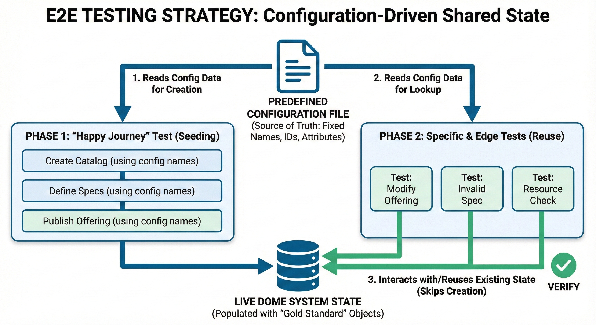

# E2E-DOME-BAE

This branch uses the images configured in DOME GitOps PRD: Scorpio `scorpiobroker/all-in-one-runner:java-5.0.3` and the 16 separate `docker.io/drllbl18/tmforum-*` APIs at `sbx_1.8.4`. An Nginx gateway keeps the shared endpoint at `http://localhost:8633` (`http://tmforum-apis:8080` inside Docker).

The gateway also maps the existing `/tmf-api/quote/v4` route to PRD's `/tmf-api/quoteManagement/v4`. Document attachment storage is not provisioned by this test stack; binary document uploads need a separate S3 service.

**Important:** Scorpio uses an AMD64 image, so it runs under emulation on Apple Silicon. Running the separate TMF services also uses more memory than the previous all-in-one container.

## Table of Contents

- [Testing Strategy: Configuration-Driven Shared State](#testing-strategy-configuration-driven-shared-state)
  - [Workflow Explanation](#workflow-explanation)
- [Usage](#usage)
  - [Run system tests](#run-system-tests)
  - [Clean and restart](#clean-and-restart)
  - [Tests with UI](#execute-tests-manually-with-ui)
  - [CI/CD](#you-can-integrate-the-tests-in-your-cicd)
- [Requirements](#requirements)

## Testing Strategy: Configuration-Driven Shared State

This project uses an optimized End-to-End (E2E) testing strategy with Playwright, designed to minimize execution time and avoid redundant data creation.

Because the marketplace flow has heavy sequential dependencies (Catalog $\rightarrow$ Specs $\rightarrow$ Offering), creating fresh foundational data for every single test is highly inefficient.

Instead of re-creating data or passing data dynamically between tests, we use a **configuration-driven approach** where a predefined file acts as the single source of truth for test data identifiers.

Our strategy is visualized below:



### Workflow Explanation

**The Source of Truth: Predefined Configuration File**
Before any tests run, a static configuration file exists containing fixed names, and other attributes for the required Catalog, Specs, and Offering. This ensures every test knows exactly "who" corresponds to "what".

**1. Phase 1: The "Happy Journey" (Seeding the System)**
* The main, positive-flow test executes first.
* It reads the **Predefined Configuration File** to know exactly what names and attributes to use.
* It executes and tests the creation actions against the live DOME system, effectively populating the environment with the expected "gold standard" objects.

**2. Phase 2: Specific & Edge Tests (Reuse)**
* Subsequent tests execute only after Phase 1 has successfully seeded the environment.
* These tests also read the **Predefined Configuration File** to find the fixed identifiers of the objects they need to interact with.
* They **skip creation steps** and directly interact with the live system, reusing the existing Catalogs, Specs, or Offerings to perform specific verifications or test edge-case scenarios.

This ensures deep test coverage without wasting time constantly rebuilding the foundational data structures.

## Usage

### Run system tests

To deploy the complete system and run the tests:

```bash
./testing-local.sh [--headed] [--noTest] <proxy_branch> <proxy_repo> <charging_branch> <charging_repo> <frontend_branch> <frontend_repo> <tm_version>
```

**Optional flags:**
- `--headed` - Run Cypress tests with GUI (default: headless mode)
- `--noTest` - Skip running tests (only build and deploy the system)

**Examples:**

Headless mode (default):
```bash
./testing-local.sh master FIWARE-TMForum/business-ecosystem-logic-proxy master FIWARE-TMForum/business-ecosystem-charging-backend main Ficodes/BAE-Frontend sbx_1.8.4
```

With GUI (headed mode):
```bash
./testing-local.sh --headed master FIWARE-TMForum/business-ecosystem-logic-proxy master FIWARE-TMForum/business-ecosystem-charging-backend main Ficodes/BAE-Frontend sbx_1.8.4
```

Only build and deploy (skip tests):
```bash
./testing-local.sh --noTest master FIWARE-TMForum/business-ecosystem-logic-proxy master FIWARE-TMForum/business-ecosystem-charging-backend main Ficodes/BAE-Frontend sbx_1.8.4
```

This command:
1. Clones the specified repositories on the indicated branches (It doesn't overwrite existing directories, to change repo/branch, it is required to remove the frontend/proxy/charging repo previously)
2. Builds the necessary Docker images
3. Deploys all services (proxy, charging, frontend, IDM, TMForum APIs, etc.)
4. Runs end-to-end tests with Cypress (headless by default, with GUI if `--headed` flag is used, or skip tests entirely with `--noTest`)

### Clean and restart

To empty the database and start over:

```bash
./cleanup.sh
```

### Reload after brought up to date (proxy and charging)

After brought the new changes (for example with git fetch --all and git pull ) you can start over with the new modifications using this command:

```bash
./reload.sh
```

### Execute tests manually with UI

If the system is already deployed, you can execute this command:
```bash
npx cypress open --e2e
```

If nothing is deployed yet, use the `--headed` flag when running the testing script:
```bash
./testing-local.sh --headed master FIWARE-TMForum/business-ecosystem-logic-proxy master FIWARE-TMForum/business-ecosystem-charging-backend main Ficodes/BAE-Frontend sbx_1.8.4
```

### You can integrate the tests in your CI/CD
The `PR System Test` workflow runs for pull requests targeting `master`, or manually through `workflow_dispatch` after pushing this branch. A push alone does not trigger it. Both workflows default to `sbx_1.8.4` when no TMF version is supplied; an explicit version overrides that default and must exist for the separate `drllbl18/tmforum-*` images.

From your forked BAE-Frontend you can send a PR to the original repo (Ficodes/BAE-Frontend) with the following data
This is the minimal text you need to trigger the system testing workflow
```txt
SYSTEM_TESTING: ACTIVATE
TM_VERSION: sbx_1.8.4
```
And this is for custom testing
```txt
SYSTEM_TESTING: ACTIVATE [needed to activate the workflow]
PROXY: https://github.com/FIWARE-TMForum/business-ecosystem-logic-proxy/tree/develop [This line is optional; default it will take master branch]
CHARGING: https://github.com/FIWARE-TMForum/business-ecosystem-charging-backend/tree/develop [This line is optional; default it will take master branch]
TM_VERSION: sbx_1.8.4
```
SYSTEM_TESTING: [needed to activate the workflow]
PROXY: [This line is optional; default it will take master branch]
CHARGING: [This line is optional; default it will take master branch]
TM_VERSION: Mandatory to se the tmforum api version

It is going to test your current Pull requested front repo@branch with the repo@branch of proxy and charging (optional) and tmforum api that you previously chose

## Requirements

- Docker and Docker Compose
- Node.js and npm
- Python 3
- Git

**Note:** The script automatically detects if you're on macOS or Linux and adjusts dependency installation accordingly.
